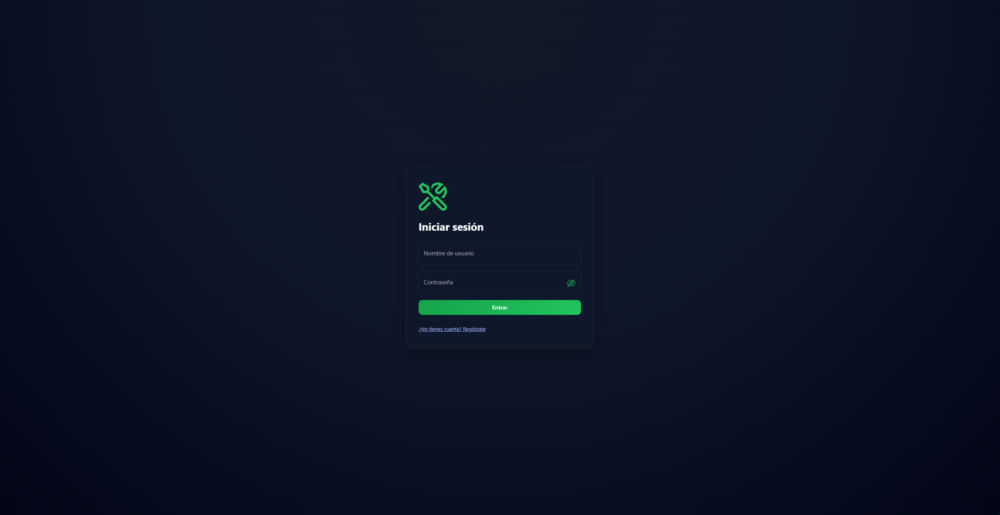
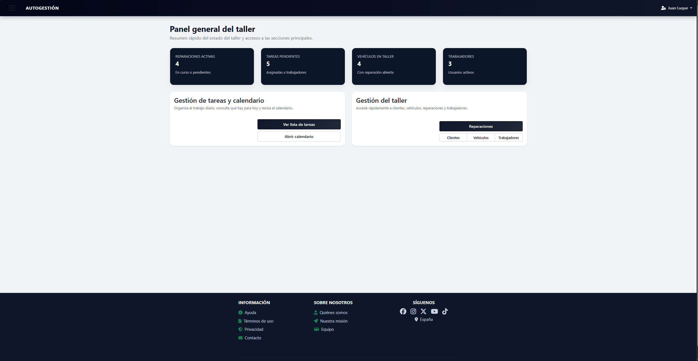
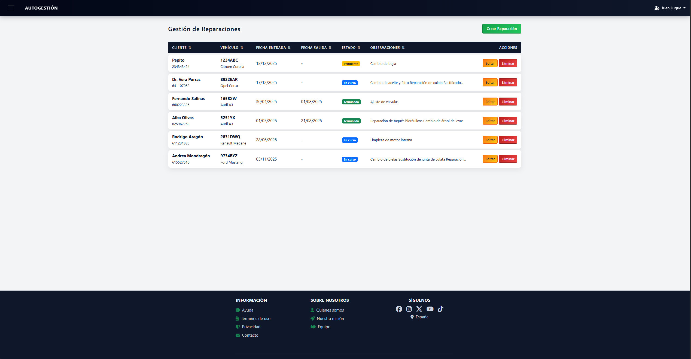
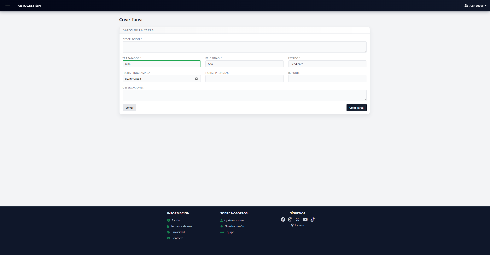
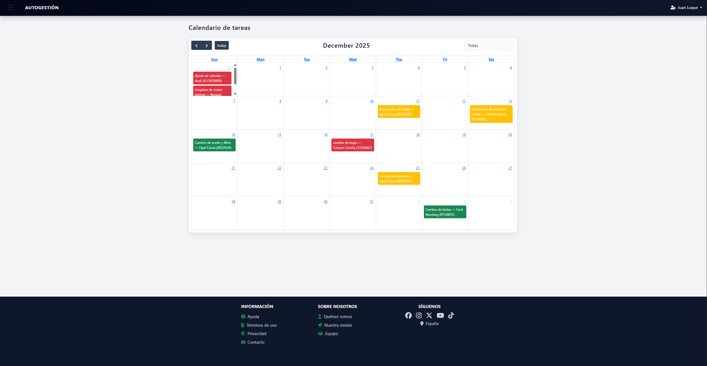
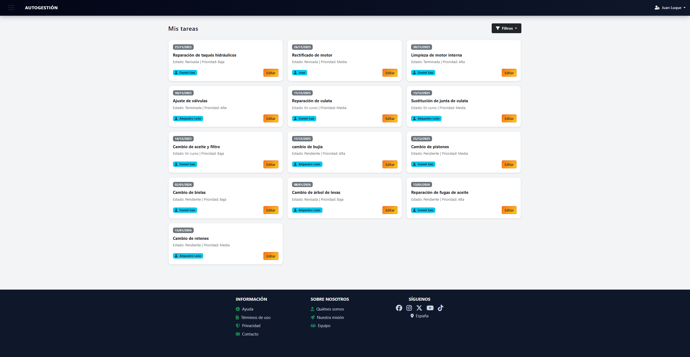
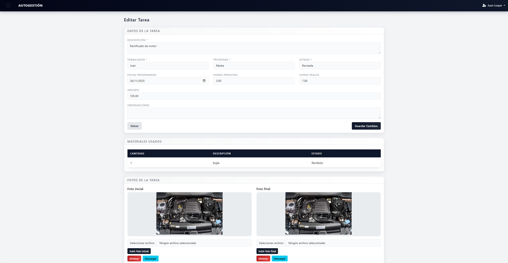

# 🔧 Gestor de Taller

Aplicación web para organizar el día a día de un taller mecánico pequeño: clientes, vehículos, reparaciones y las tareas de cada trabajador, todo en un mismo sitio.


> Proyecto final del ciclo de **Desarrollo de Aplicaciones Web (DAW)**. Actualmente es un prototipo funcional.

---

## 📖 Origen del proyecto

Mi hermano es mecánico en un taller de vehículos. Hasta ahora organiza los trabajos del taller con **una hoja de papel**: qué coche ha entrado, qué hay que hacerle, quién se encarga, qué piezas faltan por llegar… Funciona, pero tiene sus problemas: la hoja se pierde o se mancha, no hay historial de lo que se le hizo a cada coche y cuando hay más de una persona trabajando es difícil saber en qué está cada uno.

**Gestor de Taller** nace para sustituir esa hoja. La idea es que el jefe del taller registre cada coche que entra, lo divida en tareas y las reparta entre los trabajadores, y que cada trabajador vea en su móvil u ordenador qué le toca hoy, apunte las horas, los materiales que usa y suba fotos del antes y el después.

## 📝 Descripción

La aplicación tiene dos roles:

- **Jefe**: gestiona clientes, vehículos, reparaciones, trabajadores y reparte las tareas.
- **Trabajador**: ve sus tareas, las va actualizando y deja constancia del trabajo hecho.

El flujo de trabajo es el siguiente:

```
Cliente ──▶ Vehículo ──▶ Reparación ──▶ Tareas ──▶ Materiales y fotos
                          (entrada al     (asignadas a
                           taller)         un trabajador)
```

## 📸 Capturas

<!-- CAPTURA: pantalla de inicio de sesión -->


<!-- CAPTURA: panel de inicio del jefe con los contadores -->


<!-- CAPTURA: listado de reparaciones -->


<!-- CAPTURA: formulario para crear una tarea -->


<!-- CAPTURA: calendario de tareas -->


<!-- CAPTURA: "Mis tareas" desde la cuenta de un trabajador -->


<!-- CAPTURA: detalle de una tarea con materiales y fotos inicial/final -->


## ✨ Funcionalidades

### 👔 Jefe

- **Registro inicial**: la primera cuenta se crea desde `/register` y siempre es de jefe. Cuando ya hay dos jefes, el registro público se bloquea.
- **Panel de inicio** con un resumen del taller: reparaciones activas, tareas pendientes, vehículos en el taller y número de trabajadores.
- **Gestión de trabajadores**:
  - Alta con una contraseña aleatoria que se envía por correo al nuevo trabajador.
  - Edición de sus datos y cambio de rol (jefe / trabajador).
  - Restablecer la contraseña (además cierra las sesiones abiertas de ese usuario).
  - Baja de trabajadores (un jefe no se puede eliminar).
- **Clientes**: alta, edición y baja. Al dar de alta un cliente se le pueden añadir varios vehículos a la vez. Se avisa al momento si el DNI ya existe.
- **Vehículos**: alta, edición y baja con sus datos técnicos (matrícula, bastidor, motor, cilindrada, potencia, kilómetros…). Se avisa al momento si la matrícula ya existe.
- **Reparaciones**: registro de la entrada y salida de cada vehículo, estado y observaciones. Si el cliente o el vehículo no existen, se pueden crear desde una ventana emergente sin salir del formulario.
- **Tareas**: cada reparación se divide en tareas con trabajador asignado, prioridad, estado, fecha programada, horas previstas y reales e importe.
- **Seguimiento**: ver las tareas de cada trabajador agrupadas por día y todas las tareas del taller en el calendario.

### 🔩 Trabajador

- **Panel de inicio** con sus tareas de hoy, sus tareas pendientes y las horas previstas para hoy.
- **Mis tareas**: listado agrupado por día y cambio rápido de estado (`pendiente`, `en curso`, `terminada`, `revisada`). Al marcar una tarea como terminada se guarda la fecha automáticamente.
- **Detalle de la tarea**: datos del cliente y del vehículo, horas reales y observaciones.
- **Materiales**: añadir o quitar las piezas de cada tarea con su cantidad y estado (`pedido`, `recibido`, `usado`).
- **Fotos**: subir una foto inicial y una final de cada trabajo, sustituirlas, descargarlas o borrarlas.
- **Calendario** con sus tareas, coloreadas según la prioridad (alta, media o baja).

### 👥 Comunes

- Inicio y cierre de sesión con nombre de usuario y contraseña.
- Perfil editable (nombre, usuario, correo) y cambio de contraseña.
- Interfaz y mensajes de validación en español.

## 🛠️ Tecnologías

| Parte | Tecnologías |
|---|---|
| Backend | PHP 8.2+, Laravel 12 (Eloquent, Blade, middleware, Mail) |
| Base de datos | MariaDB / MySQL |
| Frontend | Bootstrap 5.3, jQuery 3.6, jQuery Validate, Select2, FullCalendar 6, Font Awesome 6 |
| Otros | `laravel-lang/lang` (traducciones al español), almacenamiento de imágenes con el disco `public` de Laravel |

Las librerías de frontend se cargan desde CDN, así que no hace falta Node.js ni `npm` para ejecutar el proyecto.

## 🚀 Instalación en local (MariaDB)

### Requisitos

- PHP 8.2 o superior con las extensiones `pdo_mysql`, `mbstring`, `fileinfo` y `gd`
- Composer
- MariaDB (o MySQL)
- Git

### 1. Clonar el repositorio e instalar dependencias

```bash
git clone https://github.com/juanluque04/gestion-taller-mecanico.git
cd gestion-taller-mecanico
composer install
```

### 2. Crear el archivo de entorno

```bash
cp .env.example .env
php artisan key:generate
```

### 3. Crear la base de datos en MariaDB

Entra en MariaDB (`sudo mariadb` o `mariadb -u root -p`) y ejecuta:

```sql
CREATE DATABASE taller CHARACTER SET utf8mb4 COLLATE utf8mb4_unicode_ci;
CREATE USER 'taller'@'localhost' IDENTIFIED BY 'taller';
GRANT ALL PRIVILEGES ON taller.* TO 'taller'@'localhost';
FLUSH PRIVILEGES;
```

### 4. Configurar el `.env`

Cambia estas líneas (las de la base de datos vienen comentadas, hay que quitar el `#`):

```env
APP_NAME="Gestor de Taller"
APP_LOCALE=es

DB_CONNECTION=mysql
DB_HOST=127.0.0.1
DB_PORT=3306
DB_DATABASE=taller
DB_USERNAME=taller
DB_PASSWORD=taller

MAIL_MAILER=log
```

Con `MAIL_MAILER=log` los correos (por ejemplo, el que recibe un trabajador nuevo con su contraseña) no se envían de verdad, sino que se escriben en `storage/logs/laravel.log`.

<details>
<summary>Opcional: enviar los correos de verdad con Gmail</summary>

Necesitas una [contraseña de aplicación](https://myaccount.google.com/apppasswords) de Google:

```env
MAIL_MAILER=smtp
MAIL_HOST=smtp.gmail.com
MAIL_PORT=587
MAIL_USERNAME=tu_correo@gmail.com
MAIL_PASSWORD=tu_contraseña_de_aplicacion
MAIL_ENCRYPTION=tls
MAIL_FROM_ADDRESS=tu_correo@gmail.com
MAIL_FROM_NAME="Gestor de Taller"
```

</details>

### 5. Crear las tablas y cargar los datos de prueba

```bash
php artisan migrate --seed
```

### 6. Enlazar la carpeta de imágenes

Hace falta para que se vean las fotos de las tareas:

```bash
php artisan storage:link
```

### 7. Arrancar el servidor

```bash
php artisan serve
```

Abre <http://127.0.0.1:8000> en el navegador.

## 👤 Usuarios de prueba

Los seeders crean estos usuarios:

| Rol | Usuario | Contraseña |
|---|---|---|
| Jefe | `juanluque` | `123456` |
| Trabajador | `trabajador1` … `trabajador50` | `password123` |

También se generan datos de ejemplo: 5 clientes con entre 1 y 3 vehículos cada uno, varias reparaciones por vehículo y tareas repartidas al azar entre los trabajadores.

> ⚠️ Son credenciales solo para pruebas en local. No las uses en un servidor real.

## 🔮 Próximas mejoras

- [ ] Comprobar que un trabajador solo pueda modificar materiales y fotos de sus propias tareas.
- [ ] Generar presupuestos y facturas en PDF a partir de las horas, el importe y los materiales de cada reparación.
- [ ] Historial completo de reparaciones de cada vehículo.
- [ ] Avisar al cliente (SMS, WhatsApp o correo) cuando su coche esté listo.
- [ ] Búsqueda y filtros en los listados de clientes, vehículos y reparaciones.
- [ ] Desplegar la aplicación en un servidor para usarla desde el móvil en el taller.

## 👨‍💻 Autor

**Juan Luque** — Proyecto final de DAW · [GitHub](https://github.com/juanluque04)
